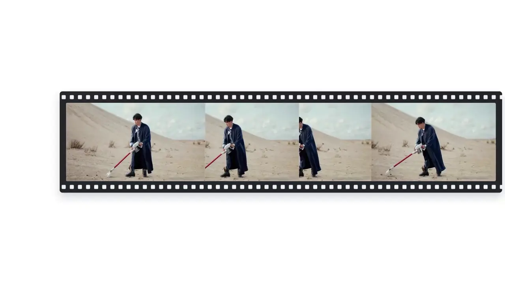
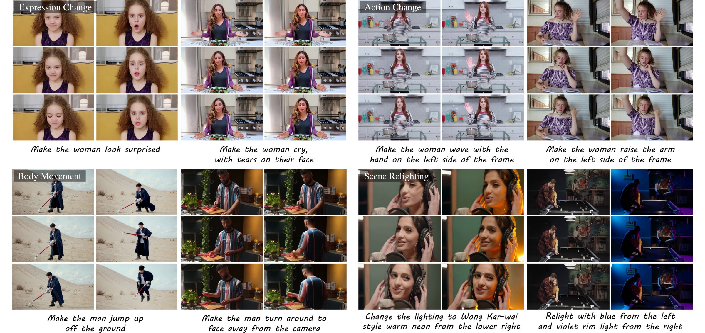

<div align="center">

<h1>I2VT: Improving and Expanding Video Editing Capabilities Without Videos</h1>

[](https://arxiv.org/abs/2611.34941)
[](https://i2v-transfer.github.io/)
[](https://huggingface.co/collections/sanaka87/i2vt-image-to-video-transfer-6b054c96986f3669623edbea)
[](https://huggingface.co/datasets/sanaka87/I2VT-17K)
[](https://huggingface.co/datasets/sanaka87/OpenVEPP-Bench)
[-fcd022?style=for-the-badge&logo=huggingface&logoColor=000)](https://huggingface.co/spaces/sanaka87/I2VT-CoF)

</div>

<div align="center">
  <a href="https://i2v-transfer.github.io/media/promo/i2vt_promo.mp4"></a>
</div>

<div align="center">
  
</div>

Image-to-Video Transfer (I2VT) improves pretrained video editors and expands them to new editing
tasks, using an image editor as the teacher and only single images as training data. The video
editor role-plays as an image editor: it edits an image as a one-frame video, and the image editor
guides its prediction at each denoising step. After fine-tuning, the video editor applies the
improved and expanded capabilities to whole clips, with no change to its architecture or sampler.
We also release OpenVE++, which extends OpenVE-Bench with action change, expression change, body
movement and scene relighting.

<div align="center">
  
</div>

## News

- **2026.11.24**: Code, the three I2VT models, the I2VT-17K training set and the OpenVE++
  benchmark are released.

## Models

Each model is a LoRA on a frozen pretrained video editor; all three are in one
[Hugging Face collection](https://huggingface.co/collections/sanaka87/i2vt-image-to-video-transfer-6b054c96986f3669623edbea).
Scores are the Overall columns of the main table in the paper (ratings from 1 to 5). OpenVE-Bench
is judged by Gemini 2.5 Pro and OpenVE++ by Gemini 3.8 Flash.

| Model | Video editor | Size | OpenVE-Bench (Gemini 2.5 Pro) | OpenVE++ (Gemini 3.8 Flash) | Weights | Training config |
|---|---|---|---|---|---|---|
| I2VT-1.3B | Bernini-R-1.3B | 1.3B | 3.42 | 3.39 | [sanaka87/i2vt-1.3b](https://huggingface.co/sanaka87/i2vt-1.3b) | [config](configs/train/i2vt-1.3b.yaml) |
| I2VT-14B | Bernini-R-14B | 14B | 3.58 | 3.77 | [sanaka87/i2vt-14b](https://huggingface.co/sanaka87/i2vt-14b) | [config](configs/train/i2vt-14b.yaml) |
| I2VT-CoF | VideoCoF | 14B | 3.13 | 4.01 | [sanaka87/i2vt-cof](https://huggingface.co/sanaka87/i2vt-cof) | [config](configs/train/i2vt-cof.yaml) |

The base editors score 3.10 and 1.54 (Bernini-R-1.3B), 3.33 and 2.30 (Bernini-R-14B) and
2.29 and 1.16 (VideoCoF).

All three are trained on [I2VT-17K](https://huggingface.co/datasets/sanaka87/I2VT-17K), 17,227
source images with editing instructions and teacher edits. The base weights (Bernini-R, VideoCoF,
Wan2.1, JoyAI-Image-Edit) are published by their authors under their own licenses and are not
redistributed here.

## Quick start

### Install

```bash
git clone https://github.com/HorizonWind2004/i2v-transfer.git && cd i2v-transfer
pip install -e '.[training,evaluation]'   # Python >= 3.10
```

### Download the weights

All weights go under `$I2V_ASSET_ROOT/checkpoints`, where the configs look for them.

```bash
export I2V_ASSET_ROOT=/path/to/assets
C=$I2V_ASSET_ROOT/checkpoints

# Base video editors. Bernini-R reads its T5 text encoder and VAE from Wan2.1-T2V-14B.
huggingface-cli download ByteDance/Bernini-R-1.3B-Diffusers --exclude "text_encoder/*" "assets/*" --local-dir $C/Bernini-R-1.3B-Diffusers
huggingface-cli download ByteDance/Bernini-R-Diffusers --exclude "text_encoder/*" "assets/*" --local-dir $C/Bernini-R-Diffusers
huggingface-cli download Wan-AI/Wan2.1-T2V-14B --local-dir $C/Wan2.1-T2V-14B

# VideoCoF LoRA and the FusionX LoRA it uses for 4-step inference (I2VT-CoF only).
huggingface-cli download XiangpengYang/VideoCoF videocof.safetensors --local-dir $C/VideoCoF
huggingface-cli download vrgamedevgirl84/Wan14BT2VFusioniX FusionX_LoRa/Wan2.1_T2V_14B_FusionX_LoRA.safetensors --local-dir $C/VideoCoF
mv $C/VideoCoF/FusionX_LoRa/Wan2.1_T2V_14B_FusionX_LoRA.safetensors $C/VideoCoF/Wan2.1_Text_to_Video_14B_FusionX_LoRA.safetensors

# Teacher image editor (training only).
huggingface-cli download jdopensource/JoyAI-Image-Edit --local-dir $C/JoyAI-Image-Edit

# I2VT LoRAs.
huggingface-cli download sanaka87/i2vt-1.3b --local-dir $C/i2vt-1.3b
huggingface-cli download sanaka87/i2vt-14b --local-dir $C/i2vt-14b
huggingface-cli download sanaka87/i2vt-cof --local-dir $C/i2vt-cof
```

The Bernini-R models need only the T5 encoder, tokenizer and VAE of Wan2.1-T2V-14B; add
`--include "Wan2.1_VAE.pth" "models_t5_umt5-xxl-enc-bf16.pth" "google/umt5-xxl/*"` to skip its
transformer if you do not use I2VT-CoF.

### Inference

Edit one video with any of the three models. The config supplies the base weights and the
inference settings of the base editor.

```bash
# I2VT-1.3B (40 steps)
python scripts/infer_video.py \
  --config configs/train/i2vt-1.3b.yaml \
  --checkpoint $I2V_ASSET_ROOT/checkpoints/i2vt-1.3b/bernini_lora_step_200.safetensors \
  --video source.mp4 --prompt "Make the person raise their right arm." --output-dir outputs/demo

# I2VT-14B (40 steps)
python scripts/infer_video.py \
  --config configs/train/i2vt-14b.yaml \
  --checkpoint $I2V_ASSET_ROOT/checkpoints/i2vt-14b/bernini_lora_step_200.safetensors \
  --video source.mp4 --prompt "Make the person raise their right arm." --output-dir outputs/demo

# I2VT-CoF (4 steps with the FusionX LoRA)
python scripts/infer_video.py \
  --config configs/train/i2vt-cof.yaml \
  --checkpoint $I2V_ASSET_ROOT/checkpoints/i2vt-cof/videocof_lora_step_200.safetensors \
  --video source.mp4 --prompt "Relight the scene with warm candlelight." --output-dir outputs/demo
```

I2VT-14B has one LoRA per expert: `--checkpoint` names the high-noise one, and
`bernini_lora_low_step_200.safetensors` is read from the same directory. `--base` runs the base
editor without the LoRA. The script writes `gen_<name>.mp4` and a side-by-side
`gen_<name>_compare.mp4`.

### Evaluation

`--mode eval` edits every benchmark clip and scores the edits with Gemini, so set
`GEMINI_API_KEY` first. Each benchmark uses the judge of the table above: Gemini 2.5 Pro
(`gemini-2.5-pro`) for OpenVE-Bench and Gemini 3.8 Flash (`gemini-3.8-flash`) for
OpenVE++. `--judge <model>` picks another one.

```bash
export GEMINI_API_KEY=...
CKPT=$I2V_ASSET_ROOT/checkpoints/i2vt-1.3b/bernini_lora_step_200.safetensors
i2vt configs/train/i2vt-1.3b.yaml --mode eval --checkpoint $CKPT --bench openve      # OpenVE-Bench
i2vt configs/train/i2vt-1.3b.yaml --mode eval --checkpoint $CKPT --bench openve_pp   # OpenVE++
```

The other two models take their own config and LoRA. Videos and score files go to
`outputs/inference/<model>/<bench>/`, and the benchmarks are downloaded from the Hub on first use.
`python scripts/summarize_scores.py --run NAME=outputs/inference/<model>/<bench>` averages the
scores of one or more runs.

### Training

One YAML file defines one run. It sets only the values that differ from the defaults in
[src/i2vt/config.py](src/i2vt/config.py), and `--dry-run` prints the full configuration.

```bash
i2vt configs/train/i2vt-1.3b.yaml --dry-run   # print the resolved configuration
i2vt configs/train/i2vt-1.3b.yaml             # I2VT-1.3B
i2vt configs/train/i2vt-14b.yaml              # I2VT-14B
i2vt configs/train/i2vt-cof.yaml              # I2VT-CoF
```

The training set is downloaded from the Hub on first use. The effective batch is
`len(student_gpus) × gradient_accumulation_steps`; keep the product when you change the number of
GPUs. [configs/README.md](configs/README.md) describes the three configs.

#### Hardware

**If you have B300 (288 GB) cards**, use the configs in `configs/train/` as they are. They put a
student rank and its own copy of the JoyAI-Image-Edit teacher on every GPU, which is how the
released models were trained.

**Without B300**, use the configs in [`configs/train/a100/`](configs/train/a100), made for A100
(80 GB). An A100 cannot hold a student and the teacher together, so the teacher runs on separate
GPUs as a small TCP server (`runtime.teacher_gpus`) and the student ranks call it for the teacher
velocity at every rollout step. `i2vt <config>` starts the teacher servers, waits until they accept
connections and then starts training; nothing else has to be launched. The result is the same
recipe, but training is much slower:

| Hardware | Time per step (48 samples) | 200 steps |
|---|---|---|
| 4 × B300, I2VT-CoF, our runs | about 80 s | about 4.5 hours |
| 2 × A100 80 GB, I2VT-14B (1 student + 1 teacher) | about 12 minutes | **about 40 hours** |
| 2 × A100 80 GB, I2VT-CoF (1 student + 1 teacher) | about 15 minutes | **about 50 hours** |
| 4 × A100 80 GB (2 students + 2 teachers) | about half of the above, estimated | about 20–25 hours, estimated |

The A100 times are measured on short runs of the A100 configs (0.067 samples/s for I2VT-14B and
0.054 for I2VT-CoF per student); the four-card row is extrapolated, not measured. The A100 configs
include the speed-ups described below, which made the A100 path 1.29× (I2VT-14B) and 1.37×
(I2VT-CoF) faster than our first A100 runs.

| Cards | Config | Students + teachers | Accumulation | Status |
|---|---|---|---|---|
| B300, 2 | `i2vt-14b.yaml`, `i2vt-cof.yaml` | 2 + 2, on the same cards | 24 | |
| B300, 3 | `i2vt-1.3b.yaml` | 3 + 3, on the same cards | 16 | |
| A100 80 GB, 2 | `a100/i2vt-14b-2gpu.yaml`, `a100/i2vt-cof-2gpu.yaml` | 1 + 1 | 48 | smoke-tested: 2 optimizer steps, checkpoint saved |
| A100 80 GB, 4 | `a100/i2vt-14b-4gpu.yaml` | 2 + 2 | 24 | not tested yet |
| A100 80 GB, 4 | `a100/i2vt-cof-4gpu.yaml` | 2 + 2 | 24 | not tested yet |
| A100 80 GB, 4 | `a100/i2vt-1.3b-4gpu.yaml` | 3 + 1 | 16 | not tested yet |

```bash
i2vt configs/train/a100/i2vt-14b-2gpu.yaml    # I2VT-14B on two A100s
i2vt configs/train/a100/i2vt-cof-2gpu.yaml    # I2VT-CoF on two A100s
```

The effective batch stays 48 in every row: `len(student_gpus) × gradient_accumulation_steps`.
The teacher servers listen on `127.0.0.1`, ports 29600 and up (`teacher.host`, `teacher.ports`);
change the ports if they are taken. Their logs are in `outputs/<name>/teacher_logs/`.

Speed-ups in the A100 configs (found with [ResearchBoost-Agent](https://github.com/DAGroup-PKU/ResearchBoost-Agent)'s
profile → change one hotspot → time → check loop):

| Change | Where | Result |
|---|---|---|
| LoRA forward without the redundant fp32 cast and the two elementwise multiplies | always on (`I2VT_FAST_LORA=0` turns it off) | bit for bit identical |
| Teacher request copies leave the GPU without blocking the training thread | always on, RPC only | bit for bit identical |
| `student.checkpoint_skip_blocks`: the last N blocks are not recomputed in backward | CoF: 4 | bit for bit identical, more memory |
| `train.rollout.chunk_size: 4`: more rollout steps in flight, so the teacher waits less | CoF | bit for bit identical, more memory |
| `student.compile_blocks`: `torch.compile` on every transformer block | CoF and 14B | not bit for bit identical (see below) |

With `compile_blocks`, a 20-step run of I2VT-CoF drifts from the eager run by as much as two eager runs
drift from each other (mean per-step loss difference 1.1% vs 0.9%; LoRA weights 0.15% vs 0.12%). For
I2VT-14B the drift is measurably larger than that noise: per-step losses differ by 2.0% on average
(0.3% between two eager runs), most of it in steps 3–6, and the LoRA weights by 0.17% vs 0.11%. Turn
it off (`compile_blocks: false`) if you need the eager numerics; I2VT-14B is then about 1.2× slower.

Notes from the A100 runs:

- **I2VT-14B on an A100 80 GB needs `train.offload_optimizer: true`**, which the A100 configs set. The
  student holds both Bernini-R experts, and without it the AdamW state tips the card over 80 GB
  when the optimizer is created. With it, the fp32 AdamW runs on the CPU (the same update, a few
  seconds per optimizer step, about 20 GB of host memory) and the GPU keeps only the weights and
  gradients.
- The A100 I2VT-CoF configs turn on `student.gradient_checkpointing`; a 14B student without it
  runs out of memory in the first rollout.
- I2VT-CoF needs the full `Wan2.1-T2V-14B` download, transformer shards included (about 65 GB). The
  T5/VAE-only subset suggested above is enough for the Bernini models but not for CoF. The
  `Bernini-R-Diffusers` download for I2VT-14B is about 107 GB.
- Tested with Python 3.10. On Python 3.14 the data loader fails to start its workers.

## Benchmark

[OpenVE++](https://huggingface.co/datasets/sanaka87/OpenVEPP-Bench) adds 207 clips in four task
groups to OpenVE-Bench and uses the same scoring protocol. Its source clips do not appear in the
training data. `--bench openve_pp` evaluates all four groups.

| Task group | Clips |
|---|---|
| Action Change | 73 |
| Expression Change | 42 |
| Body Movement | 42 |
| Scene Relighting | 50 |

## Citation

```bibtex
@misc{xie2026improvingexpandingvideoediting,
      title={Improving and Expanding Video Editing Capabilities Without Videos}, 
      author={Ji Xie and Yanhao Jia and Xiangpeng Yang and Martin Q. Ma and Sihan Xu and Erik Cambria and Louis-Philippe Morency},
      year={2026},
      eprint={2611.34941},
      archivePrefix={arXiv},
      primaryClass={cs.CV},
      url={https://arxiv.org/abs/2611.34941}, 
}
```

## License

Apache License 2.0 (see [LICENSE](LICENSE)). Vendored third-party code and its licenses are
listed in [NOTICE](NOTICE).

## Acknowledgements

I2VT builds on [Bernini](https://github.com/bytedance/Bernini),
[VideoCoF](https://github.com/knightyxp/VideoCoF), [Wan2.1](https://github.com/Wan-Video/Wan2.1),
[JoyAI-Image-Edit](https://github.com/jd-opensource/JoyAI-Image) and
[OpenVE](https://github.com/OpenVE-Team/OpenVE-3M). IVEBench numbers use the official
[IVEBench](https://github.com/RyanChenYN/IVEBench) code. We thank the authors for releasing their
work. The A100 training speed-ups were found with
[ResearchBoost-Agent](https://github.com/DAGroup-PKU/ResearchBoost-Agent) by DAGroup-PKU.
