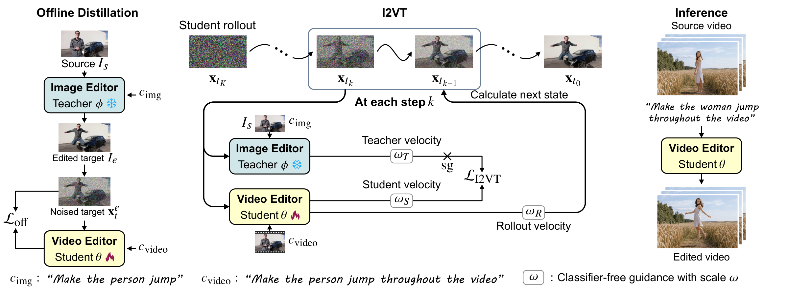

<div align="center">

<h1>I2VT: Improving and Expanding Video Editing Capabilities Without Videos</h1>

[](https://arxiv.org/abs/2611.34941)
[](https://i2v-transfer.github.io/)
[](https://huggingface.co/collections/sanaka87/i2vt-image-to-video-transfer-6b054c96986f3669623edbea)
[](https://huggingface.co/datasets/sanaka87/I2VT-17K)
[](https://huggingface.co/datasets/sanaka87/OpenVEPP-Bench)
[-fcd022?style=for-the-badge&logo=huggingface&logoColor=000)](https://huggingface.co/spaces/sanaka87/I2VT-CoF)

</div>

<div align="center">
  <a href="https://i2v-transfer.github.io/media/promo/i2vt_promo.mp4"></a>
</div>

<div align="center">
  
</div>

Image-to-Video Transfer (I2VT) improves pretrained video editors and expands them to new editing
tasks, using an image editor as the teacher and only single images as training data. The video
editor role-plays as an image editor: it edits an image as a one-frame video, and the image editor
guides its prediction at each denoising step. After fine-tuning, the video editor applies the
improved and expanded capabilities to whole clips, with no change to its architecture or sampler.
We also release OpenVE++, which extends OpenVE-Bench with action change, expression change, body
movement and scene relighting.

<div align="center">
  
</div>

## News

- **2026.11.24**: Code, the three I2VT models, the I2VT-17K training set and the OpenVE++
  benchmark are released.

## Models

Each model is a LoRA on a frozen pretrained video editor; all three are in one
[Hugging Face collection](https://huggingface.co/collections/sanaka87/i2vt-image-to-video-transfer-6b054c96986f3669623edbea).
Scores are the Overall columns of the main table in the paper (ratings from 1 to 5). OpenVE-Bench
is judged by Gemini 2.5 Pro and OpenVE++ by Gemini 3.8 Flash.

| Model | Video editor | Size | OpenVE-Bench (Gemini 2.5 Pro) | OpenVE++ (Gemini 3.8 Flash) | Weights | Training config |
|---|---|---|---|---|---|---|
| I2VT-1.3B | Bernini-R-1.3B | 1.3B | 3.42 | 3.39 | [sanaka87/i2vt-1.3b](https://huggingface.co/sanaka87/i2vt-1.3b) | [config](configs/train/i2vt-1.3b.yaml) |
| I2VT-14B | Bernini-R-14B | 14B | 3.58 | 3.77 | [sanaka87/i2vt-14b](https://huggingface.co/sanaka87/i2vt-14b) | [config](configs/train/i2vt-14b.yaml) |
| I2VT-CoF | VideoCoF | 14B | 3.13 | 4.01 | [sanaka87/i2vt-cof](https://huggingface.co/sanaka87/i2vt-cof) | [config](configs/train/i2vt-cof.yaml) |

The base editors score 3.10 and 1.54 (Bernini-R-1.3B), 3.33 and 2.30 (Bernini-R-14B) and
2.29 and 1.16 (VideoCoF).

All three are trained on [I2VT-17K](https://huggingface.co/datasets/sanaka87/I2VT-17K), 17,227
source images with editing instructions and teacher edits. The base weights (Bernini-R, VideoCoF,
Wan2.1, JoyAI-Image-Edit) are published by their authors under their own licenses and are not
redistributed here.

## Quick start

### Install

```bash
git clone https://github.com/HorizonWind2004/i2v-transfer.git && cd i2v-transfer
pip install -e '.[training,evaluation]'   # Python >= 3.10
```

### Download the weights

All weights go under `$I2V_ASSET_ROOT/checkpoints`, where the configs look for them.

```bash
export I2V_ASSET_ROOT=/path/to/assets
C=$I2V_ASSET_ROOT/checkpoints

# Base video editors. Bernini-R reads its T5 text encoder and VAE from Wan2.1-T2V-14B.
huggingface-cli download ByteDance/Bernini-R-1.3B-Diffusers --exclude "text_encoder/*" "assets/*" --local-dir $C/Bernini-R-1.3B-Diffusers
huggingface-cli download ByteDance/Bernini-R-Diffusers --exclude "text_encoder/*" "assets/*" --local-dir $C/Bernini-R-Diffusers
huggingface-cli download Wan-AI/Wan2.1-T2V-14B --local-dir $C/Wan2.1-T2V-14B

# VideoCoF LoRA and the FusionX LoRA it uses for 4-step inference (I2VT-CoF only).
huggingface-cli download XiangpengYang/VideoCoF videocof.safetensors --local-dir $C/VideoCoF
huggingface-cli download vrgamedevgirl84/Wan14BT2VFusioniX FusionX_LoRa/Wan2.1_T2V_14B_FusionX_LoRA.safetensors --local-dir $C/VideoCoF
mv $C/VideoCoF/FusionX_LoRa/Wan2.1_T2V_14B_FusionX_LoRA.safetensors $C/VideoCoF/Wan2.1_Text_to_Video_14B_FusionX_LoRA.safetensors

# Teacher image editor (training only).
huggingface-cli download jdopensource/JoyAI-Image-Edit --local-dir $C/JoyAI-Image-Edit

# I2VT LoRAs.
huggingface-cli download sanaka87/i2vt-1.3b --local-dir $C/i2vt-1.3b
huggingface-cli download sanaka87/i2vt-14b --local-dir $C/i2vt-14b
huggingface-cli download sanaka87/i2vt-cof --local-dir $C/i2vt-cof
```

The Bernini-R models need only the T5 encoder, tokenizer and VAE of Wan2.1-T2V-14B; add
`--include "Wan2.1_VAE.pth" "models_t5_umt5-xxl-enc-bf16.pth" "google/umt5-xxl/*"` to skip its
transformer if you do not use I2VT-CoF.

### Inference

Edit one video with any of the three models. The config supplies the base weights and the
inference settings of the base editor.

```bash
# I2VT-1.3B (40 steps)
python scripts/infer_video.py \
  --config configs/train/i2vt-1.3b.yaml \
  --checkpoint $I2V_ASSET_ROOT/checkpoints/i2vt-1.3b/bernini_lora_step_200.safetensors \
  --video source.mp4 --prompt "Make the person raise their right arm." --output-dir outputs/demo

# I2VT-14B (40 steps)
python scripts/infer_video.py \
  --config configs/train/i2vt-14b.yaml \
  --checkpoint $I2V_ASSET_ROOT/checkpoints/i2vt-14b/bernini_lora_step_200.safetensors \
  --video source.mp4 --prompt "Make the person raise their right arm." --output-dir outputs/demo

# I2VT-CoF (4 steps with the FusionX LoRA)
python scripts/infer_video.py \
  --config configs/train/i2vt-cof.yaml \
  --checkpoint $I2V_ASSET_ROOT/checkpoints/i2vt-cof/videocof_lora_step_200.safetensors \
  --video source.mp4 --prompt "Relight the scene with warm candlelight." --output-dir outputs/demo
```

I2VT-14B has one LoRA per expert: `--checkpoint` names the high-noise one, and
`bernini_lora_low_step_200.safetensors` is read from the same directory. `--base` runs the base
editor without the LoRA. The script writes `gen_<name>.mp4` and a side-by-side
`gen_<name>_compare.mp4`.

### Evaluation

`--mode eval` edits every benchmark clip and scores the edits with Gemini, so set
`GEMINI_API_KEY` first. Each benchmark uses the judge of the table above: Gemini 2.5 Pro
(`gemini-2.5-pro`) for OpenVE-Bench and Gemini 3.8 Flash (`gemini-3.8-flash`) for
OpenVE++. `--judge <model>` picks another one.

```bash
export GEMINI_API_KEY=...
CKPT=$I2V_ASSET_ROOT/checkpoints/i2vt-1.3b/bernini_lora_step_200.safetensors
i2vt configs/train/i2vt-1.3b.yaml --mode eval --checkpoint $CKPT --bench openve      # OpenVE-Bench
i2vt configs/train/i2vt-1.3b.yaml --mode eval --checkpoint $CKPT --bench openve_pp   # OpenVE++
```

The other two models take their own config and LoRA. Videos and score files go to
`outputs/inference/<model>/<bench>/`, and the benchmarks are downloaded from the Hub on first use.
`python scripts/summarize_scores.py --run NAME=outputs/inference/<model>/<bench>` averages the
scores of one or more runs.

### Training

One YAML file defines one run. It sets only the values that differ from the defaults in
[src/i2vt/config.py](src/i2vt/config.py), and `--dry-run` prints the full configuration.

```bash
i2vt configs/train/i2vt-1.3b.yaml --dry-run   # print the resolved configuration
i2vt configs/train/i2vt-1.3b.yaml             # I2VT-1.3B
i2vt configs/train/i2vt-14b.yaml              # I2VT-14B
i2vt configs/train/i2vt-cof.yaml              # I2VT-CoF
```

The training set is downloaded from the Hub on first use. The effective batch is
`len(student_gpus) × gradient_accumulation_steps`; keep the product when you change the number of
GPUs. [configs/README.md](configs/README.md) describes the three configs.

#### Hardware

**With B300 (288 GB):** use `configs/train/` as is; this is how the released models were trained.

**With A100 (80 GB):** use [`configs/train/a100/`](configs/train/a100). The teacher runs on its own
GPUs and `i2vt <config>` starts it for you. Same recipe, slower:

| Hardware | Config | Per step (48 samples) | 200 steps |
|---|---|---|---|
| 4 × B300 | `i2vt-cof.yaml` | ~80 s | ~4.5 h |
| 2 × A100 | `a100/i2vt-14b-2gpu.yaml` | ~12 min | ~40 h |
| 2 × A100 | `a100/i2vt-cof-2gpu.yaml` | ~15 min | ~50 h |
| 4 × A100 | `a100/*-4gpu.yaml` | ~half, untested | ~20–25 h, untested |

```bash
i2vt configs/train/a100/i2vt-14b-2gpu.yaml
```

Notes:
- I2VT-CoF needs the full `Wan2.1-T2V-14B` download (~65 GB); `Bernini-R-Diffusers` is ~107 GB.
- The A100 configs use `torch.compile` (`student.compile_blocks`). It is not bit for bit identical to
  eager; set it to `false` for eager numerics (I2VT-14B is then ~1.2× slower).
- Tested with Python 3.10.

## Benchmark

[OpenVE++](https://huggingface.co/datasets/sanaka87/OpenVEPP-Bench) adds 207 clips in four task
groups to OpenVE-Bench and uses the same scoring protocol. Its source clips do not appear in the
training data. `--bench openve_pp` evaluates all four groups.

| Task group | Clips |
|---|---|
| Action Change | 73 |
| Expression Change | 42 |
| Body Movement | 42 |
| Scene Relighting | 50 |

## Citation

```bibtex
@misc{xie2026improvingexpandingvideoediting,
      title={Improving and Expanding Video Editing Capabilities Without Videos}, 
      author={Ji Xie and Yanhao Jia and Xiangpeng Yang and Martin Q. Ma and Sihan Xu and Erik Cambria and Louis-Philippe Morency},
      year={2026},
      eprint={2611.34941},
      archivePrefix={arXiv},
      primaryClass={cs.CV},
      url={https://arxiv.org/abs/2611.34941}, 
}

@misc{he2025openve,
      title={{OpenVE-3M}: A Large-Scale High-Quality Dataset for Instruction-Guided Video Editing},
      author={Haoyang He and Jie Wang and Jiangning Zhang and Zhucun Xue and Xingyuan Bu and Qiangpeng Yang and Shilei Wen and Lei Xie},
      year={2025},
      eprint={2512.07826},
      archivePrefix={arXiv},
      primaryClass={cs.CV},
      url={https://arxiv.org/abs/2512.07826}
}
```

## License

Apache License 2.0 (see [LICENSE](LICENSE)). Vendored third-party code and its licenses are
listed in [NOTICE](NOTICE).

## Acknowledgements

I2VT builds on [Bernini](https://github.com/bytedance/Bernini),
[VideoCoF](https://github.com/knightyxp/VideoCoF), [Wan2.1](https://github.com/Wan-Video/Wan2.1),
[JoyAI-Image-Edit](https://github.com/jd-opensource/JoyAI-Image) and
[OpenVE](https://github.com/OpenVE-Team/OpenVE-3M). IVEBench numbers use the official
[IVEBench](https://github.com/RyanChenYN/IVEBench) code. We thank the authors for releasing their
work. The A100 training speed-ups were found with
[ResearchBoost-Agent](https://github.com/DAGroup-PKU/ResearchBoost-Agent) by DAGroup-PKU.
